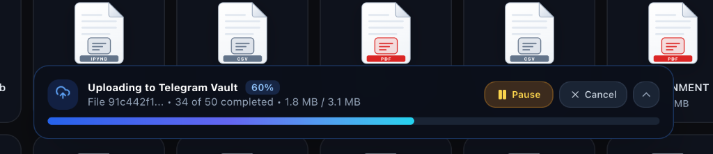
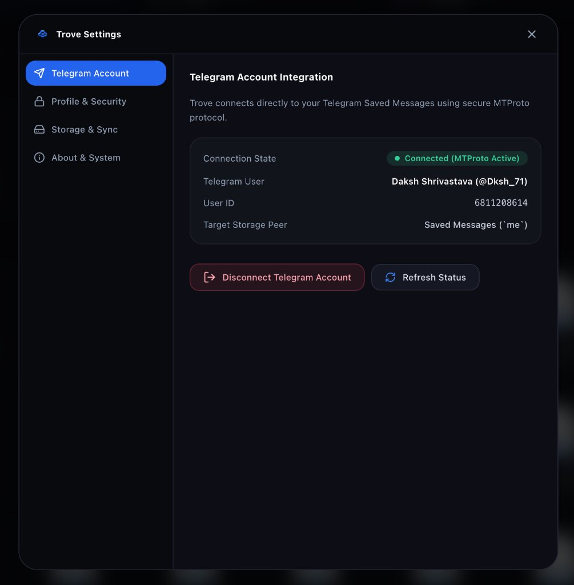
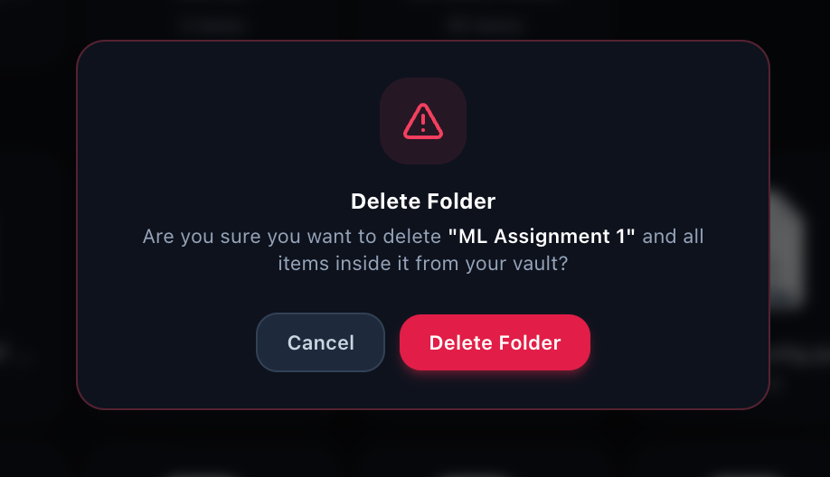
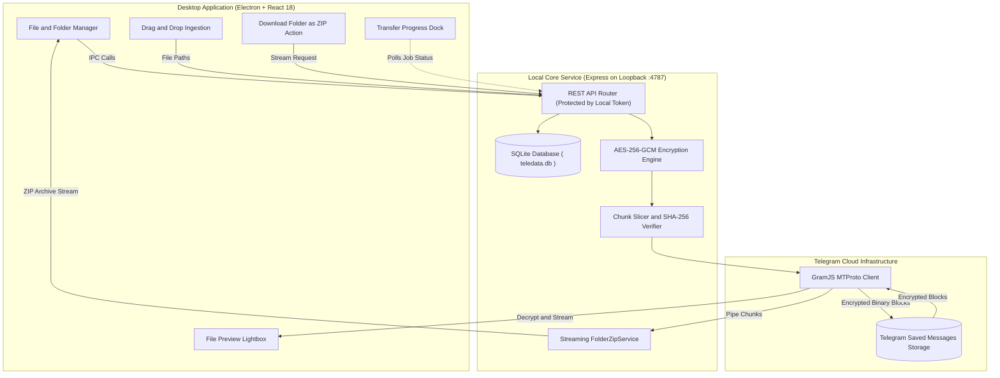

<p align="center">
  
</p>

<h1 align="center">
  <span style="color: #2563eb; font-size: 2.8rem; font-weight: 800; letter-spacing: 3px;">T R O V E</span>
</h1>

<p align="center">
  <b>Personal Encrypted Cloud Storage Backed by Telegram MTProto</b><br>
  <i>Your files, your local keys, your cloud. High-capacity personal vault with zero monthly subscriptions.</i>
</p>

<p align="center">
  
  
  
  
  
</p>

---

<p align="center">
  
</p>

---

## Table of Contents

- [About Trove](#about-trove)
- [How It Works](#how-it-works)
- [Core Features](#core-features)
- [Application Walkthrough](#application-walkthrough)
- [System Architecture](#system-architecture)
- [Security and Privacy](#security-and-privacy)
- [Project Structure](#project-structure)
- [Installation and Setup](#installation-and-setup)
- [Frequently Asked Questions](#frequently-asked-questions)
- [GitHub Repository Topics](#github-repository-topics)
- [License and Author](#license-and-author)

---

## About Trove

Trove is an open-source, local-first cross-platform desktop application for **Windows** and **macOS** that turns your personal Telegram account into a private, high-capacity cloud drive.

### The Problem
Traditional cloud providers like Google Drive, Dropbox, and OneDrive lock users into recurring monthly subscription fees once they pass small free storage tiers (typically 5 GB to 15 GB). Furthermore, standard cloud services store files unencrypted on their servers, meaning your documents, photos, and source code can be scanned or inspected.

### The Trove Solution
Telegram provides generous, free document storage through its MTProto protocol. Trove acts as a specialized desktop client that connects directly to your own Telegram account. 

Before any file leaves your computer, Trove encrypts it on your device using AES-256-GCM. The encrypted data is then sliced into safe parts and stored inside your personal Telegram "Saved Messages" chat. Trove maintains a local SQLite database that indexes filenames, folder trees, and checksums so you can search, browse, organize, preview, and download your files just like a regular hard drive.

---

## How It Works

1. **Local Encryption**: You select a file or folder. Trove reads the raw bytes and encrypts them locally using AES-256-GCM and a private master key stored exclusively on your device.
2. **Chunk Slicing**: Large files are split into manageable chunks (from 20 MB up to 2 GB) so they upload reliably without timing out.
3. **Telegram Upload**: Trove sends each encrypted chunk to your personal Telegram "Saved Messages" chat using the official Telegram MTProto protocol.
4. **Local Indexing**: The file name, folder hierarchy, chunk IDs, and SHA-256 checksums are saved in a local SQLite database on your computer.
5. **On-Demand Retrieval**: When you preview or download a file, Trove pulls the encrypted chunks from Telegram, decrypts them in memory or temporary storage, and reconstructs the original file instantly.

---

## Core Features

### High-Capacity Cloud Storage
Stores your files directly in your Telegram Saved Messages chat. There are no monthly subscription bills, no artificial storage tiers, and no hidden account fees.

### True Client-Side Encryption
Uses AES-256-GCM authenticated encryption. Your master key is generated locally on your Mac and never sent across the internet. Telegram servers only receive scrambled ciphertext blocks and cannot read your file names or contents.

### Download Folder as ZIP
Download any folder and all of its nested subfolders as a standard `.zip` archive with one click. Trove streams each file directly from Telegram into the archive on disk, keeping memory consumption low regardless of folder size.

### Smart Folder Upload Filter
When uploading entire project directories, Trove automatically skips unnecessary compiler outputs, dependencies, and hidden cache directories (such as `node_modules`, `.venv`, `.git`, `.cache`, and `.DS_Store`). This prevents wasting bandwidth and storage on files that can be recreated locally with package managers.

### Live Transfer Dock
A persistent bottom progress dock displays active upload and download progress in real time. It shows current transfer speed, file counts, megabytes transferred, and includes one-click Pause and Cancel buttons.

### Offline-First Browsing
All vault metadata (filenames, folders, dates, file sizes) is stored in a local SQLite database. If your internet disconnects, your file list remains fully visible, searchable, and organized.

### Instant Media and Document Preview
Preview photos, video clips, audio files, code, and text files directly inside the app without needing to download the full file to your Desktop first.

### Safe Deletion Guards
Deleting folders triggers a confirmation modal to prevent accidental data loss. Deleting a folder recursively removes all nested files from both your local database index and your Telegram Saved Messages storage.

### Low CPU and Battery Friendly
Engineered with single-instance interval timers and smart polling backoffs. When idle, Trove consumes less than 2% CPU, keeping your MacBook cool and saving battery.

---

## Application Walkthrough

### 1. Main Vault Dashboard
The primary interface provides a clear overview of your cloud storage metrics, root folders, and recent files.

<p align="center">
  
</p>

- **Top Bar**: Search bar with keyboard shortcut (`Ctrl+K`), vault synchronization button, direct Upload buttons, and view switcher (grid or list).
- **Metric Cards**: Real-time counters showing Total Stored bytes, Indexed Files count, Local Cache size, and Upload Queue status.
- **Folder Grid**: Interactive folder cards showing item counts and quick-action buttons on hover.
- **File Grid**: Categorized file cards with size indicators and integrity status dots.

---

### 2. Live Transfer Progress Dock
The transfer dock provides live feedback during batch uploads and downloads.

<p align="center">
  
</p>

- Shows the active file name, current completion percentage, and completed file count (e.g. `34 of 50 completed`).
- Includes interactive **Pause** and **Cancel** buttons to control transfers on the fly.

---

### 3. Telegram MTProto Integration and Security
The settings panel gives you full transparency over your Telegram connection.

<table align="center" width="100%">
  <tr>
    <td align="center" width="50%" valign="top">
      
      <br><br>
      <b>Telegram Connection Settings</b><br>
      <sub>Displays active MTProto session, connected Telegram username, user ID, and target storage peer.</sub>
    </td>
    <td align="center" width="50%" valign="top">
      
      <br><br>
      <b>Safe Deletion Modal</b><br>
      <sub>Confirms before deleting a folder and cascading the delete to all nested items.</sub>
    </td>
  </tr>
</table>

---

### 4. Simple First-Time Setup Flow
Connecting your Telegram account takes less than two minutes.

<table align="center" width="100%">
  <tr>
    <td align="center" width="50%" valign="top">
      
      <br><br>
      <b>Step 1: Phone Verification</b><br>
      <sub>Enter your phone number to receive an official login code directly inside your Telegram app.</sub>
    </td>
    <td align="center" width="50%" valign="top">
      
      <br><br>
      <b>Step 2: Free Telegram API Keys</b><br>
      <sub>Paste your free App API ID and API Hash from my.telegram.org to enable direct MTProto communication.</sub>
    </td>
  </tr>
</table>

---

## System Architecture

Trove runs as two cooperating processes on your local machine: an Electron desktop application for the user interface, and a lightweight background Express service that handles cryptography, database management, and MTProto network calls.



### Architecture Highlights
- **No Third-Party Servers**: Network requests travel solely between your Mac and Telegram's official MTProto servers.
- **Protected Loopback API**: The backend listens strictly on `127.0.0.1`. Requests require an internal bearer token that changes per installation.
- **Streaming Pipeline**: Large files and folder ZIP archives are piped using Node.js readable/writable streams to prevent high memory usage.

---

## Security and Privacy

### Encryption Standard
- **Cipher**: AES-256-GCM (Galois/Counter Mode).
- **Authentication**: Every segment contains an authentication tag that detects any modification or corruption in transit.
- **Master Key**: Derived locally and stored on your Mac in `~/Library/Application Support/Trove/data/master.key`. It is never uploaded anywhere.

### What Telegram Sees
- Telegram servers only see generic binary document attachments sent to your private "Saved Messages".
- Telegram does not see your original filenames, folder paths, MIME types, or unencrypted file contents.

### Local Credential Storage
- Your Telegram session string and API token are stored locally inside `~/Library/Application Support/Trove/`.
- The repository `.gitignore` strictly blocks all session files, database files, and keys from ever being committed to Git.

---

## Project Structure

```
TROVE/
├── assets/                     # Screenshots, diagrams, and application icons
├── backend/                    # Core loopback service (Express, SQLite, MTProto)
│   ├── src/api/                # API routes (files, folders, uploads, downloads)
│   ├── src/database/           # SQLite migrations, repositories, and models
│   ├── src/downloads/          # File streamer and download manager
│   ├── src/folders/            # Folder management and FolderZipService
│   ├── src/security/           # AES-256-GCM, SecretBox, API Token Guard
│   ├── src/telegram/           # GramJS client, session store, FloodWait handler
│   └── src/uploads/            # Chunk calculator, staging, and upload queue
├── desktop/                    # Native Desktop App (Electron 33 + React 18 + Vite)
│   ├── electron/               # Main process, preload bridge, backend supervisor
│   ├── src/components/         # UI components (FileManager, FolderCard, Header)
│   ├── src/context/            # React context providers (App, Auth, Transfers)
│   └── release/                # Packaged binaries (macOS ARM64 DMG & ZIP)
├── shared/                     # Shared TypeScript types and contracts
├── .env.example                # Example environment configuration
├── .gitignore                  # Security exclusions (keys, sessions, venvs)
└── README.md                   # Project documentation
```

---

## Installation and Setup

### Method 1: Windows (Recommended for Windows 10 & 11)

Trove offers two Windows distributions:
1. **Interactive Installer (NSIS)**:
   - Download **[Trove Setup 0.1.0.exe](https://github.com/Daksh-create349/TROVE/releases/download/v0.1.0/Trove.Setup.0.1.0.exe)** from [GitHub Releases](https://github.com/Daksh-create349/TROVE/releases/tag/v0.1.0).
   - Run the installer. Choose custom install location, enable Desktop and Start Menu shortcuts, and complete setup.
   - SHA-256 Checksum: `2b88430b24b15de0907eacb3f7ca536006431074f0d39579f208f88025760c4e`
2. **Standalone Portable Executable**:
   - Download **[Trove 0.1.0.exe](https://github.com/Daksh-create349/TROVE/releases/download/v0.1.0/Trove.0.1.0.exe)**.
   - Run directly without installation.
   - SHA-256 Checksum: `8de53739da5c63689e2e126a1cc93227e37d138d14778b334685527a28187c91`

Verify checksum in PowerShell:
```powershell
Get-FileHash "Trove Setup 0.1.0.exe" -Algorithm SHA256
```

---

### Method 2: macOS (Apple Silicon M1 / M2 / M3 / M4)

1. Download **[Trove-0.1.0-arm64.dmg](https://github.com/Daksh-create349/TROVE/releases/download/v0.1.0/Trove-0.1.0-arm64.dmg)** from [GitHub Releases](https://github.com/Daksh-create349/TROVE/releases/tag/v0.1.0).
2. Open the `.dmg` file and drag **Trove** into your **Applications** folder.
3. Open Trove from Applications or Spotlight.
4. Verify checksum in Terminal:
   ```bash
   shasum -a 256 Trove-0.1.0-arm64.dmg
   # bf62b0fa0ebb57685c968ee089d4fc3f8db76eb333093a7544d1307c50e57adb
   ```

---

### Method 3: Building from Source
Ensure you have **Node.js 20+** and **npm** installed.

1. **Clone the repository:**
   ```bash
   git clone https://github.com/Daksh-create349/TROVE.git
   cd TROVE
   ```

2. **Install backend dependencies and compile server:**
   ```bash
   cd backend
   npm install --ignore-scripts
   npm run build
   ```

3. **Install desktop dependencies:**
   ```bash
   cd ../desktop
   npm install
   ```

4. **Run in development mode:**
   ```bash
   npm run dev
   ```

5. **Package for your operating system:**
   - **Windows**: `npm run package:win` (produces `Trove Setup 0.1.0.exe` and `Trove 0.1.0.exe` in `desktop/release/`)
   - **macOS**: `npm run package:mac` (produces `.dmg` and `.zip` in `desktop/release/`)
   - **Linux**: `npm run package:linux` (produces `AppImage` and `.deb` in `desktop/release/`)

---

## Frequently Asked Questions

### Does Telegram charge for this storage?
No. Telegram provides cloud document storage as part of its standard service. Trove interfaces with your account using Telegram's official developer API.

### Can Telegram read my files?
No. All files are encrypted with AES-256-GCM on your Mac before they leave your computer. Telegram only stores encrypted binary data. Without your local master key, the data cannot be read.

### What happens if my internet connection drops during an upload?
Trove tracks uploads by segment. If your connection drops, the active transfer pauses. Once reconnected, you can resume the upload from where it stopped rather than starting over.

### Why were some files in my folder skipped during upload?
Trove is designed to keep your cloud vault clean and fast. When you upload a project directory, it automatically skips common developer cache directories like `node_modules`, `.venv`, `.git`, `.cache`, and `.DS_Store`. Your actual source code and documents are uploaded completely.

### Can I download an entire folder back to my computer?
Yes. Click the "Download as ZIP" button on any folder card or in the toolbar. Trove packages the entire folder tree into a single `.zip` file and saves it wherever you choose on your Mac.

---

## GitHub Repository Topics

When configuring your repository on GitHub, use the following description and topics:

### About Description
> Personal encrypted cloud storage desktop app that turns Telegram Saved Messages into a private, high-capacity cloud drive.

### Topics / Tags
`cloud-storage` · `telegram-mtproto` · `electron` · `react` · `typescript` · `aes-256-gcm` · `windows` · `macos` · `desktop-app` · `privacy` · `file-manager` · `local-first` · `sqlite` · `zero-knowledge`

---

## License and Author

- **Author**: Daksh Shrivastava
- **License**: MIT License. See [LICENSE](LICENSE) for details.
