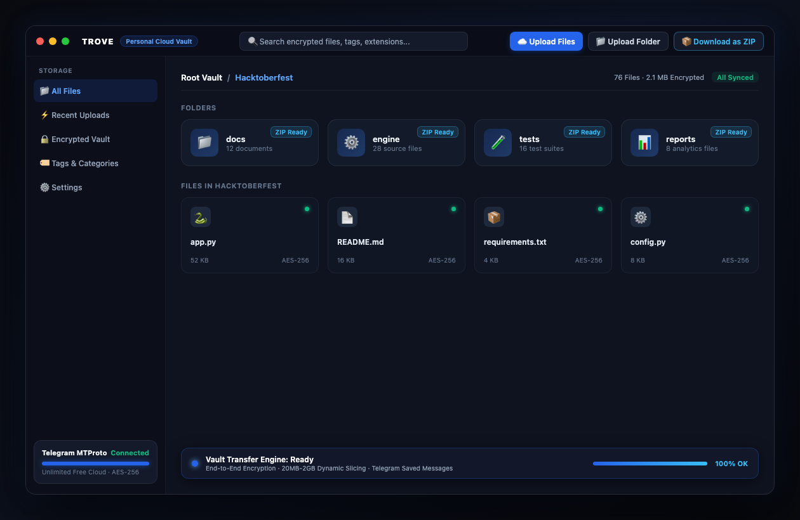
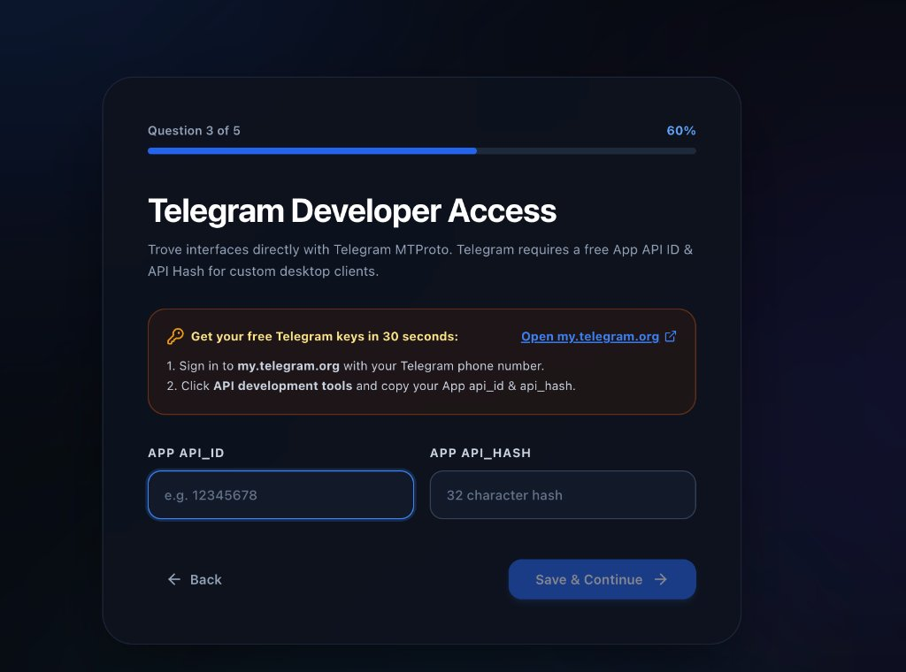
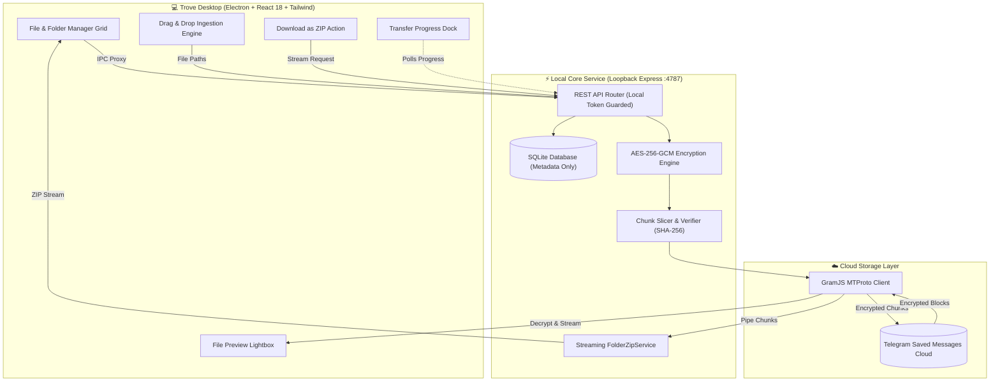

<p align="center">
  
</p>

<h1 align="center">
  <span style="color: #2563eb; font-size: 2.8rem; font-weight: 800; letter-spacing: 3px;">T R O V E</span>
</h1>

<p align="center">
  <b>Personal Encrypted Cloud Storage Backed by Telegram MTProto</b><br>
  <i>Your files, your local keys, your cloud. High-capacity personal vault with zero monthly subscriptions.</i>
</p>

<p align="center">
  
  
  
  
  
</p>

---

<p align="center">
  
</p>

---

## ⚡ What is Trove?

**Trove** transforms your personal Telegram account's private "Saved Messages" into a high-speed, military-grade encrypted personal cloud filesystem. 

Traditional cloud storage platforms limit you with strict quotas and recurring subscriptions. Trove provides a private, modern desktop interface to store, organize, preview, and download your files and entire folder trees seamlessly — without ever storing unencrypted files on any third-party server.

---

## ✨ Key Features

- 🔐 **Zero-Knowledge Client-Side Encryption**: Every file is encrypted locally on your machine using **AES-256-GCM** with a master key derived from your credentials. Telegram only sees randomized ciphertext blocks.
- 📦 **Download Folder as ZIP**: Right-click or hover over any folder to package and stream entire nested directory hierarchies directly into a standard `.zip` archive on your Mac with zero RAM spikes.
- ⚡ **Dynamic Chunking & Slicing**: Automatically fragments large files into safe 20 MB – 2 GB MTProto chunks, uploads them with exponential-backoff retries, and reconstructs them transparently on demand.
- 📁 **Smart Folder Walker**: When uploading whole folders, Trove automatically ignores compiler junk and local environments (`node_modules`, `.venv`, `.git`, `.cache`, `.DS_Store`) to keep your vault clean and fast.
- 🔋 **Battery & CPU Optimized**: Built for all-day laptop efficiency. Eliminates infinite re-render loops with single-instance interval timers and smart polling backoffs (< 2% idle CPU).
- 📴 **Offline-First SQLite Cache**: Local SQLite metadata database means your folders and filenames are instantly browsable even when offline.
- 🖼️ **Instant Previews**: Stream and view photos, videos, audio, and documents directly inside Trove without downloading the full files to disk.
- 🍎 **Native macOS Desktop App**: Designed specifically for Apple Silicon with frameless dark-mode styling, macOS traffic lights, drag-and-drop ingestion, and native save dialogs.

---

## 📸 Screenshots & Setup Flow

<table align="center" width="100%">
  <tr>
    <td align="center" width="50%">
      <br>
      <br><b>1. Instant Phone & OTP Login</b><br>
      <sub>Direct official Telegram authentication without third-party brokers.</sub>
    </td>
    <td align="center" width="50%">
      <br>
      <br><b>2. Free Telegram Developer API Keys</b><br>
      <sub>Link your own free API ID & API Hash from my.telegram.org in under 30 seconds.</sub>
    </td>
  </tr>
</table>

---

## 🏛️ System Architecture

Trove is built as a split-process, local-first desktop application. The Electron frontend communicates with an embedded, loopback-only Express daemon which talks to Telegram via the GramJS MTProto client.



---

## 📂 Project Structure

```
TROVE/
├── assets/                     # Official logos, screenshots, and visual mockups
├── backend/                    # Core loopback service (Express, SQLite, MTProto)
│   ├── src/api/                # REST endpoints (files, folders, uploads, downloads)
│   ├── src/database/           # SQLite migrations, repositories, and schema
│   ├── src/downloads/          # File streamer & download manager
│   ├── src/folders/            # Folder management & FolderZipService
│   ├── src/security/           # AES-256-GCM, SecretBox, API Token Guard
│   ├── src/telegram/           # GramJS client, session store, FloodWait handlers
│   └── src/uploads/            # Chunk calculation, staging, and upload queue
├── desktop/                    # Native Desktop App (Electron 33 + React 18 + Vite)
│   ├── electron/               # Main process, preload bridge, backend supervisor
│   ├── src/components/         # UI components (FileManager, FolderCard, Header)
│   ├── src/context/            # AppContext, AuthContext, TransferContext
│   └── release/                # Packaged binaries (macOS ARM64 DMG & ZIP)
├── shared/                     # Shared TypeScript types and contracts
├── .env.example                # Example environment configuration
├── .gitignore                  # Security exclusions (keys, sessions, venvs)
└── README.md                   # Project documentation
```

---

## 🚀 Getting Started

### Prerequisites
- **macOS** (Apple Silicon M1/M2/M3/M4 or Intel)
- **Node.js** >= 20.x
- **npm** >= 10.x
- Free Telegram API ID & Hash from [my.telegram.org](https://my.telegram.org)

### Installation from Source

1. **Clone the repository:**
   ```bash
   git clone https://github.com/Daksh-create349/TROVE.git
   cd TROVE
   ```

2. **Install dependencies:**
   ```bash
   # Install backend dependencies
   cd backend && npm install

   # Install desktop dependencies
   cd ../desktop && npm install
   ```

3. **Run in Development Mode:**
   ```bash
   # From the desktop directory
   cd desktop
   npm run dev
   ```

4. **Package for macOS (Generate DMG):**
   ```bash
   cd desktop
   npm run package:mac
   ```
   The built `.dmg` installer and `.app` bundle will be ready in `desktop/release/`.

---

## 🔒 Security & Privacy Model

- **No Remote Servers**: Trove does not operate any intermediate proxy or cloud relay. All traffic is direct from your machine to Telegram's MTProto datacenters.
- **Client-Side Key Derivation**: The master key (`master.key`) never leaves your local machine (`~/Library/Application Support/Trove/data/master.key`).
- **Cryptographic Envelope**: Every file payload is encrypted with authenticated **AES-256-GCM**. Tampering or corruption during transit is automatically caught via authentication tags.
- **Strict Dotfile Exclusions**: Uploading a project folder will never leak `.env` secrets, `.git` histories, or compiler binaries to the cloud.

---

## 📄 License & Credits

Built with precision by **Daksh Shrivastava**.  
Distributed under the **MIT License**.
