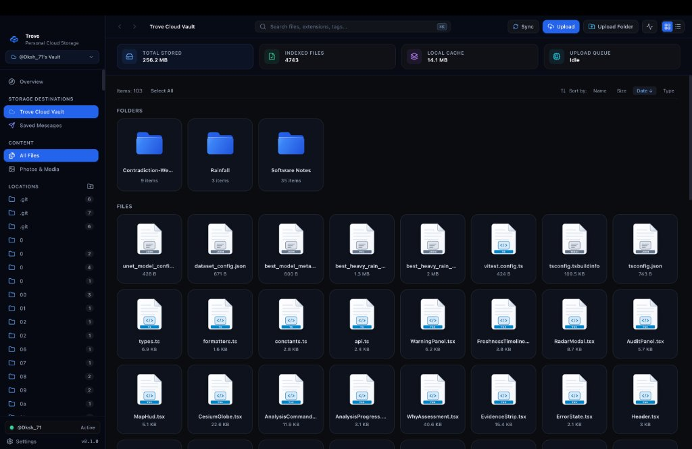
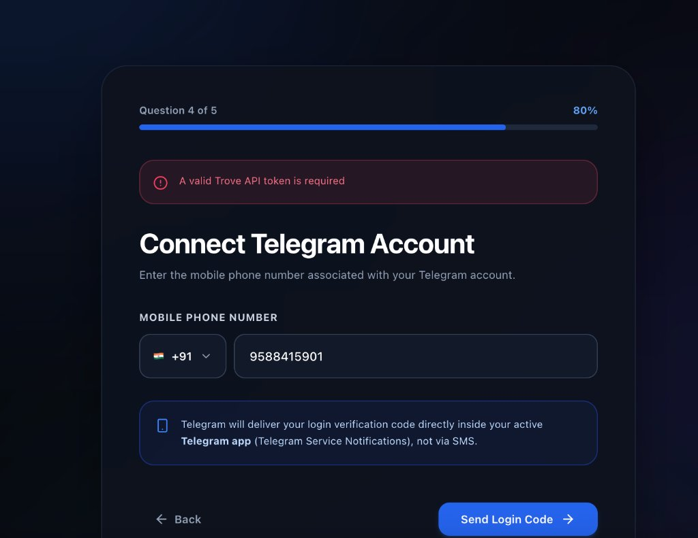
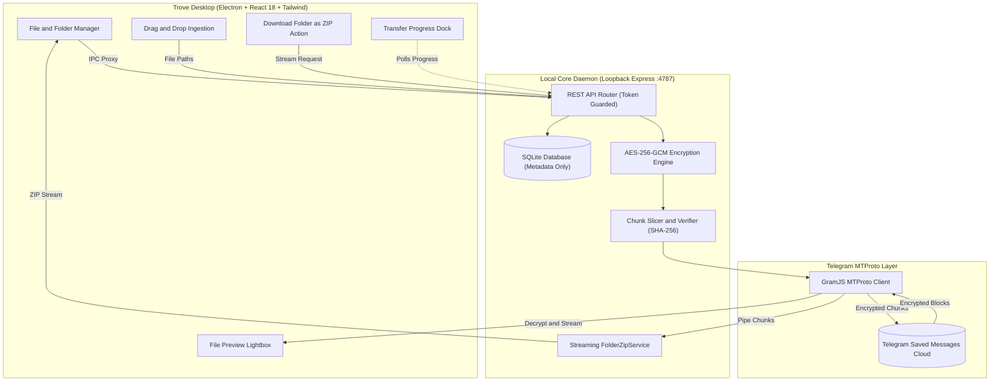

<p align="center">
  
</p>

<h1 align="center">
  <span style="color: #2563eb; font-size: 2.8rem; font-weight: 800; letter-spacing: 3px;">T R O V E</span>
</h1>

<p align="center">
  <b>Personal Encrypted Cloud Storage Backed by Telegram MTProto</b><br>
  <i>Your files, your local keys, your cloud. High-capacity personal vault with zero monthly subscriptions.</i>
</p>

<p align="center">
  
  
  
  
  
</p>

---

<p align="center">
  
</p>

---

## What is Trove?

Trove transforms your personal Telegram account's private "Saved Messages" into a high-speed, client-side encrypted personal cloud storage filesystem.

Traditional cloud providers impose arbitrary monthly storage tiers and recurring subscription fees. Trove offers an open, private, local-first macOS desktop application that lets you upload, organize, preview, and download files and nested folder hierarchies without ever exposing unencrypted data to any third-party server.

---

## Key Features

- **Zero-Knowledge Client-Side Encryption**: Every file is encrypted on your machine using authenticated **AES-256-GCM** before transmission. Telegram MTProto servers store only randomized ciphertext segments.
- **Download Folder as ZIP**: Right-click or hover on any folder card to package and stream entire nested directory hierarchies directly into a standard `.zip` archive on your Mac with zero RAM spikes.
- **Dynamic Chunk Slicing**: Large files are automatically fragmented into safe 20 MB to 2 GB MTProto chunks with cryptographic SHA-256 integrity verification on every segment.
- **Smart Directory Filter**: When uploading directories, Trove automatically skips local compiler artifacts and virtual environments (`node_modules`, `.venv`, `.git`, `.cache`, `.DS_Store`) to keep your cloud vault lightweight.
- **Real-Time Transfer Dock**: Floating transfer monitor displaying active file counts, transfer speeds, progress percentages, and pause/resume/cancel controls.
- **Offline-First SQLite Cache**: All folder hierarchies and file metadata are indexed locally in SQLite, keeping your library browsable and responsive regardless of network connectivity.
- **Safe Folder & Batch Deletions**: Cascade file deletion with modal confirmations to prevent accidental data loss.
- **Native macOS Desktop Application**: Optimized for Apple Silicon (M1/M2/M3/M4) with frameless dark-mode aesthetics, native window controls, and system file dialogs.
- **Battery and CPU Efficiency**: Built with single-instance interval timers and smart polling backoffs (< 2% idle CPU usage).

---

## Application Showcase

<p align="center">
  
  <br>
  <sub><b>Live Transfer Dock</b>: Real-time chunking progress, active file counter, and transfer controls.</sub>
</p>

<br>

<table align="center" width="100%">
  <tr>
    <td align="center" width="50%" valign="top">
      
      <br><br>
      <b>Telegram MTProto Settings</b><br>
      <sub>Direct connection status, user identity, and storage peer management.</sub>
    </td>
    <td align="center" width="50%" valign="top">
      
      <br><br>
      <b>Safe Folder Deletion</b><br>
      <sub>Confirmation guards to safely remove folders and cascaded contents from the vault.</sub>
    </td>
  </tr>
  <tr>
    <td align="center" width="50%" valign="top">
      
      <br><br>
      <b>Official Phone & OTP Login</b><br>
      <sub>Direct official Telegram authentication without third-party services.</sub>
    </td>
    <td align="center" width="50%" valign="top">
      
      <br><br>
      <b>Telegram API Key Configuration</b><br>
      <sub>Connect your own free API ID and API Hash from my.telegram.org in under a minute.</sub>
    </td>
  </tr>
</table>

---

## System Architecture

Trove operates as a split-process architecture. The Electron desktop renderer communicates with an embedded, loopback-only Express daemon that manages database transactions, cryptographic operations, and MTProto transport via GramJS.



---

## Project Structure

```
TROVE/
├── assets/                     # Application screenshots, diagrams, and logos
├── backend/                    # Core loopback service (Express, SQLite, MTProto)
│   ├── src/api/                # REST endpoints (files, folders, uploads, downloads)
│   ├── src/database/           # SQLite migrations, repositories, and schema
│   ├── src/downloads/          # File streamer and download manager
│   ├── src/folders/            # Folder management and FolderZipService
│   ├── src/security/           # AES-256-GCM, SecretBox, API Token Guard
│   ├── src/telegram/           # GramJS client, session store, FloodWait handlers
│   └── src/uploads/            # Chunk calculation, staging, and upload queue
├── desktop/                    # Native Desktop App (Electron 33 + React 18 + Vite)
│   ├── electron/               # Main process, preload bridge, backend supervisor
│   ├── src/components/         # UI components (FileManager, FolderCard, Header)
│   ├── src/context/            # AppContext, AuthContext, TransferContext
│   └── release/                # Packaged binaries (macOS ARM64 DMG & ZIP)
├── shared/                     # Shared TypeScript types and contracts
├── .env.example                # Example environment configuration
├── .gitignore                  # Security exclusions (keys, sessions, venvs)
└── README.md                   # Project documentation
```

---

## Getting Started

### Prerequisites
- macOS (Apple Silicon M1/M2/M3/M4 or Intel)
- Node.js >= 20.x
- npm >= 10.x
- Free Telegram API ID & Hash from [my.telegram.org](https://my.telegram.org)

### Building from Source

1. **Clone the repository:**
   ```bash
   git clone https://github.com/Daksh-create349/TROVE.git
   cd TROVE
   ```

2. **Install dependencies:**
   ```bash
   # Install backend dependencies
   cd backend && npm install

   # Install desktop dependencies
   cd ../desktop && npm install
   ```

3. **Run in Development Mode:**
   ```bash
   cd desktop
   npm run dev
   ```

4. **Package for macOS (Generate DMG):**
   ```bash
   cd desktop
   npm run package:mac
   ```
   The `.dmg` installer and `.app` bundle will be generated in `desktop/release/`.

---

## Security and Privacy Model

- **Direct Communication**: Trove operates with zero intermediary relay servers. All communication travels directly between your computer and Telegram's MTProto datacenters.
- **Client-Side Key Derivation**: Master keys remain strictly on your local machine (`~/Library/Application Support/Trove/data/master.key`) and are never transmitted over the network.
- **Authenticated Encryption**: Every uploaded segment uses AES-256-GCM with distinct IVs. Any tampering or packet corruption in transit is rejected immediately.
- **Exclusion Safeguards**: Scanning and uploading directories intentionally excludes hidden credentials, local virtual environments, and compiler caches.

---

## License

Author: **Daksh Shrivastava**  
License: **MIT**
